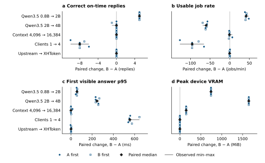
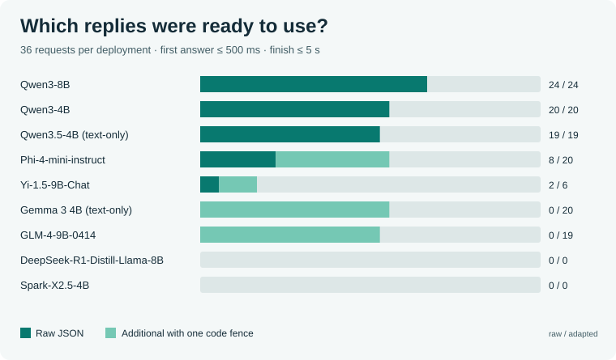

# The six-gigabyte test

A model card can tell you how a checkpoint scored on the publisher's test rig.
At home, the job is often a receipt total, an address to mask, or a detail
buried in a note you'd rather keep on your own computer. I wanted to know
which model I'd leave running on a laptop for jobs like those.

The laptop is an RTX 3060 with **6 GiB of VRAM**, running Ubuntu 24.04 under
Windows WSL2. Thirteen local deployments get the same English and Chinese notes,
planted identifiers, and archive lookups. Every benchmark request goes to a
local endpoint. We score each reply for correctness and how soon it arrives.

[Open the interactive results](https://jfang2048.github.io/llm_benchmark/#home-lab) ·
[Explore the paired tests](https://jfang2048.github.io/llm_benchmark/#controlled) ·
[中文说明](docs/zh/home-lab.md)

## The jump from 0.8B to 2B paid off

In six paired runs, Qwen3.5-2B got **11 of 18 jobs right**. Its 0.8B sibling
got 6 and the 4B sibling also got 11. Going from 2B to 4B took peak VRAM from
**1,678 to 3,326 MiB** and stretched the first visible answer p95 from 194 to
440 ms. All three used the same Q4_K_M quantization and upstream llama.cpp build.

**More clients made the desk feel slower.** Going from one to four clients
raised aggregate output from 83 to 98 tokens/s with two server slots.
First visible answer p95 rose from 194 to 750 ms. With the same half-second
target on both sides, usable replies fell from 142 to 46 per minute.

Reserving 16,384 total context tokens for the same prompts cost the 2B model
**150 MiB more**. With one Qwen3-4B weight file, the two llama.cpp builds
scored alike and used the same peak VRAM. The median change in first-answer
p95 was 1.5 ms. Each comparison used six matched pairs and the same deadlines.
[See the paired ranges and test setup](docs/controlled.md).



## The 13-deployment scorecard

**I'd start with Qwen3.5-2B on this laptop.** It returned 22/36 correct
replies on time at a peak of 1753 MiB. Qwen3-8B returned 24/36 and peaked at
4922 MiB. The 2B model also had a shorter wait for the first answer on its
correct replies, with a p95 of 250 ms versus 460 ms.

**For a batch, look at the count as well as the rate.** LFM2.5-1.2B-Instruct
had the highest raw-JSON rate at 169.0 usable jobs per minute. It finished
12/36 requests correctly and on time. Fast invalid replies still leave work
to review.

| Deployment | Desk on time | Desk first-answer p95 (ms) | Batch on time | Batch usable/min | Peak VRAM (MiB) |
|---|---:|---:|---:|---:|---:|
| Qwen3-8B | 24/36 | 460 | 24/36 | 97.0 | 4922 |
| Qwen3.5-2B (text-only) | 22/36 | 250 | 22/36 | 148.2 | 1753 |
| Qwen3-4B | 20/36 | 291 | 20/36 | 98.0 | 3244 |
| Qwen3.5-4B (text-only) | 19/36 | 513 | 23/36 | 77.5 | 3270 |
| LFM2.5-1.2B-Instruct | 12/36 | 93 | 12/36 | 169.0 | 1199 |
| Qwen3.5-0.8B (text-only) | 12/36 | 162 | 11/36 | 97.3 | 1009 |
| Phi-4-mini-instruct | 8/36 | 276 | 7/36 | 41.5 | 3158 |
| Yi-1.5-9B-Chat | 2/36 | 132 | 1/36 | 2.4 | 5124 |
| Spark-X2.5-4B | 0/36 | 2676 | 0/36 | 0.0 | 2926 |
| DeepSeek-R1-Distill-Llama-8B | 0/36 | 3129 | 0/36 | 0.0 | 4806 |
| Gemma 3 4B (text-only) | 0/36 | — | 0/36 | 0.0 | 3088 |
| GLM-4-9B-0414 | 0/36 | — | 0/36 | 0.0 | 5180 |
| SmolLM3-3B | 0/36 | — | 0/36 | 0.0 | 2533 |

All four new models streamed with every layer on the GPU at 16,384 total
tokens, or 8,192 per slot. Qwen3.5-0.8B used 1153 MiB in that probe. The
Qwen3-8B reference reached 5964 MiB with the same slot allocation. The desk
winner repeated planted identifiers in 6 of its 12 visible masking replies.
For known identifiers, I'd keep a deterministic masking step.

[Lightweight models and context checks](docs/lightweight.md) · [Per-task results](docs/home-lab-results.md)



## What makes a model worth running?

For one person, the target is a first visible answer within **500 ms** and a
finished reply within **5 seconds**. For a small batch with four requests in
flight, those limits are **2 seconds** and **8 seconds**. **Usable jobs per
minute** counts replies that meet both limits and get the task right. Peak
VRAM tells you how much of the 6 GiB card is still available.

The test uses 18 synthetic cases, two repeats per workload, and two
workloads per model. The starting score uses JSON exactly as returned.
The dashboard can accept one Markdown code fence from the same response so
you can see what a small parser changes. The older serving sweeps show how
the same machine behaves when it keeps generating tokens under load.
[Home Lab protocol](docs/home-lab.md) · [Serving results](docs/results.md)

## What changes under WSL2?

In a same-laptop check, Phi-4-mini reached health in a median of **3.36 s**
from the WSL Linux filesystem and **22.85 s** from the Windows mount. We
pre-read the same weight and launched it three times per path. Both paths
used the same WSL2 GPU and image. Native Linux would be a separate paired
test.
[Setup and measurement notes](docs/home-lab.md#wsl2-is-part-of-the-machine)

## Try it on your own machine

```bash
make setup-home
make benchmark-home RUN=.agent/home-local
make home-summary RUN=.agent/home-local
make report HOME_RUN=.agent/home-local
```

The model registry pins the weights and serving images. The benchmark binds
to loopback and uses public, invented records. Keep your model client,
logging, and any tools in mind before sending it private material.
[Start with one model](docs/home-lab.md#start-with-one-model) ·
[Reproduce the full test](docs/home-lab.md#reproduce) ·
[Model and weight sources](docs/model-selection.md)

## Follow the results

- [Home Lab details](docs/home-lab.md) explains the task set, the time budgets,
  the masking check, and the WSL2 test.
- [Paired tests](docs/controlled.md) show what changed when we varied checkpoint size,
  context, client load, or the engine build one at a time.
- [Serving results](docs/results.md) covers throughput, tail latency, memory,
  queueing, long inputs, and the short 4B sweep.
- [Coding results](docs/capability-results.md) covers separate correctness and
  software-engineering evaluations.
- [Published run files](results/current/home-lab/) hold request outcomes,
  timings, the synthetic cases, and machine and model metadata.
- [Documentation index](docs/README.md) links the rest of the project.

Model weights follow their upstream licenses. This repository publishes
measurements and fixtures. The weights come from their publishers.
