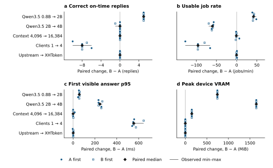

# Paired local inference benchmark

## 1. Experimental design

Five comparisons vary one deployment setting per pair. Each comparison
contains six pairs of fresh server launches (three A→B and three B→A).
Each launch replays 18 synthetic cases. The run comprised 60 launches,
120 warm-up requests and 1,080 measured requests. The unit of analysis for
each effect is one launch pair (n = 6 per comparison).

**Table 1 | Experimental conditions.** A is the baseline and B is the
changed setting. Context is measured in total tokens across two server slots.

| Factor | A | B | Held fixed |
|---|---|---|---|
| Checkpoint size | Qwen3.5-0.8B | Qwen3.5-2B | Text-only Qwen3.5, Bartowski Q4_K_M, upstream llama.cpp, one client, 4,096 tokens |
| Checkpoint size | Qwen3.5-2B | Qwen3.5-4B | Same settings as the 0.8B–2B comparison |
| Context allocation | 4,096 tokens | 16,384 tokens | Qwen3.5-2B, upstream llama.cpp, one client |
| Client concurrency | One client | Four clients | Qwen3.5-2B, upstream llama.cpp, 4,096 tokens |
| Serving build | Upstream llama.cpp | XHToken llama.cpp | Same Qwen3-4B Q4_K_M GGUF, one client, 4,096 tokens |

The size contrasts compare checkpoints within one family. Each checkpoint
includes its architecture and training. The engine contrast includes the
chat formatter, GPU kernels and scheduler of each build. Both report the
same token counts and scoring outcome in all 108 matched request pairs.

## 2. Execution and instrumentation

- **Host.** RTX 3060 Laptop GPU (6,144 MiB), NVIDIA driver 610.74, Ubuntu
  24.04 on WSL2 (kernel `6.18.33.2-microsoft-standard-WSL2`). The two
  llama.cpp images use CUDA 13.3.1. The manifest records container IDs,
  source commits, GGUF checksums and runner and fixture hashes.
- **Workload.** The 18 cases span extraction, masking and archive lookup,
  with three English and three Chinese cases per task. Both arms receive
  the same permutation, generated from seed `10517 + pair number`. Input
  lengths range from 51 to 809 tokens in the measured runs.
- **Launch sequence.** One server runs at a time. Launches start at or below
  60 °C. Each server completes one short warm-up and one archive warm-up.
  The timed window begins before dispatch and ends when all 18 results
  have arrived. A closed-loop pool replenishes requests as workers free up.
- **Runtime.** Two server slots, F16 K/V caches, greedy decoding, reasoning
  off, a 192-token output cap and a 30 s client timeout. The runner verifies
  full GPU layer offload, the allocated context per slot and zero reused
  prompt tokens at the start of every measured and warm-up request.
- **Sampling.** All times use the client monotonic clock. The GPU sampler
  records whole-device VRAM at 500 ms intervals during warm-up and
  measurement. Peak VRAM is the maximum of those samples and the
  reading at server readiness.

[Design and seed](../configs/controlled.json) · [Manifest](../results/current/controlled/manifest.json) · [Task contract](home-lab.md) · [ACM SIGPLAN empirical evaluation guidelines](https://sigplan-pages.sigplan.hosting.acm.org/Resources/EmpiricalEvaluation/)

## 3. Measures and analysis

| Measure | Run-level definition |
|---|---|
| Correct replies (count) | Response matches the expected JSON fields, types and values. The denominator is 18 requests. |
| Correct on-time replies (count) | Correct, first visible content within 500 ms and stream complete within 5 s. Both workloads use these thresholds. |
| Usable job rate (jobs/min) | 60 × correct on-time replies / timed window in seconds. |
| Output throughput (tokens/s) | Sum of reported completion tokens / timed window in seconds. |
| First visible answer and end-to-end latency (ms) | Time from dispatch to visible content or stream end, respectively. The p95 uses linear interpolation between ordered observations, following `bench.stats.percentile`. |
| Peak device VRAM (MiB) | Whole-device sampled maximum. The dashboard also reports the peak minus the pre-launch device reading. |

All 1,080 measured streams completed and provided visible text and usage,
so each reported run-level latency p95 uses 18 observations. Each paired
effect is B minus A within the same launch pair. We summarize the six
differences by their median and observed minimum and maximum. The same
18 fixtures are replayed throughout. The spans describe variation across
launch pairs on this machine and workload.

## 4. Results



**Figure 1 | Paired effects of deployment settings.** Panels (a–d) show
correct on-time replies, usable job rate, first-visible-answer p95 and peak
device VRAM, respectively. Each circle or square is one launch pair
(n = 6 per comparison per panel). Circles denote A first and open squares
denote B first. Diamonds mark paired medians. Horizontal segments span
the observed minimum and maximum. Small vertical offsets separate pairs
within a comparison. The vertical reference at zero denotes equal
measured values. Horizontal scales vary by panel.

**Table 2 | Run-level correctness and paired changes.** Correct and
on-time columns show arm medians out of 18 requests. The remaining
columns report the median paired change [minimum, maximum] over six pairs.

| Change | Correct A → B | On time A → B | First visible p95 Δ (ms) | Usable job rate Δ (jobs/min) | Peak VRAM Δ (MiB) |
|---|---:|---:|---:|---:|---:|
| Qwen3.5-0.8B → 2B | 6 → 11 | 6 → 11 | +57.2 [+45.8, +60.0] | +41.6 [+38.7, +48.5] | +744 [+744, +744] |
| Qwen3.5-2B → 4B | 11 → 11 | 11 → 11 | +246.1 [+233.0, +267.6] | −60.1 [−69.0, −56.8] | +1,648 [+1,648, +1,648] |
| Context 4,096 → 16,384 | 11 → 11 | 11 → 11 | +0.6 [−0.5, +15.4] | −0.8 [−2.2, +6.5] | +150 [+150, +150] |
| One → four clients | 11 → 11 | 11 → 3 | +556.0 [+540.5, +645.8] | −95.7 [−126.9, −65.6] | 0 [0, 0] |
| Upstream → XHToken | 10 → 10 | 10 → 10 | +1.5 [−3.3, +3.4] | −0.2 [−1.1, +0.8] | 0 [0, 0] |

Four clients increased median aggregate output throughput from 82.76 to
98.13 tokens/s. The paired change was +15.25 tokens/s, with an observed
range of +14.96 to +16.69 tokens/s. Client latency includes queueing at
two server slots. The context contrast measures the memory reserved for
the same 51–809-token inputs. The
[deployment scorecard](home-lab-results.md) has a separate four-client budget
of 2 s and 8 s and computes its latency percentiles on correct replies.

The vLLM 0.26.0 GGUF preflight stopped at worker initialization with
`RuntimeError: UVA is not available`. It used the Qwen3-4B GGUF, eager
execution, 2,048 tokens per sequence and two sequences. Table 2 covers
the two llama.cpp images that completed both arms.

## 5. Data and reproduction

The request archive records task IDs, scoring and streaming timings.
The launch manifest records per-run durations, settings and provenance.
The GPU archive contains all 767 samples. The plot-data file provides A,
B and B−A for each pair and metric.

[Plot data (TSV)](data/controlled-pairs.tsv) · [Request rows](../results/current/controlled/requests.tsv) · [GPU samples](../results/current/controlled/gpu.tsv) · [Interactive results](https://jfang2048.github.io/llm_benchmark/#controlled)

Run the following from the repository root on a Docker host with a CUDA GPU.

```bash
./scripts/build.sh
./scripts/download_models.sh qwen3_5_08b_light qwen3_5_2b_light qwen3_5_4b_compact qwen3_4b_compact
python3 -m bench.controlled --output .agent/controlled-local
python3 -m bench.controlled_report .agent/controlled-local
```

To regenerate the published dashboard, SVG figures and plot data, install
the report dependencies and run the generator.

```bash
python3 -m venv .agent/report-env
.agent/report-env/bin/python -m pip install -r requirements-report.txt
make report REPORTPY=.agent/report-env/bin/python
```

The vector figures use labeled axes, distinct marker shapes and captions
that define the sample and interval. [Nature research figure specifications](https://research-figure-guide.nature.com/figures/preparing-figures-our-specifications/)
