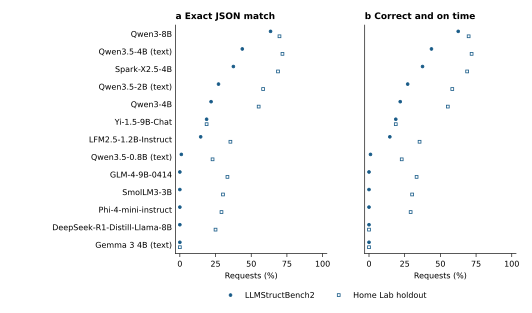
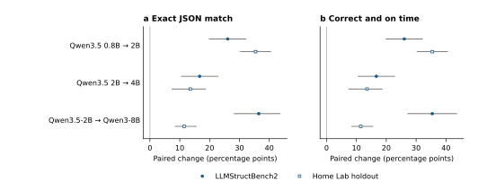

# Expanded Home Lab inference study

## 1. Corpus and provenance

Each of 13 deployments submits the same 192 distinct cases in the same
seeded queue order, for 2,496 measured requests. The two corpora are evaluated
separately. Each deployment runs one pass with two clients and two server
slots. The [later model refresh](model-refresh.md) extends the same protocol
with additional deployments and a repeated bridge arm.

**Table 1 | Corpus composition.**

| Corpus | Cases | Design | Task |
|---|---:|---|---|
| LLMStructBench2 v1.0 | 96 | Eight scenarios × two length tiers × two presentation conditions × three distinct records | Extract the complete schema-defined record from an English email |
| Home Lab holdout | 96 | Three task families × two languages × four templates × four fresh cases | Extract typed fields, mask identifiers or look up a value in a short archive |

The selection criteria were a dated public revision, text input that
fits the target context, structured reference answers and redistribution
terms. LLMStructBench2 meets these requirements for short email extraction.
ExtractBench and AOE measure complementary PDF and long-document workloads.
[ExtractBench paper](https://arxiv.org/abs/2607.29677) · [AOE proceedings paper](https://aclanthology.org/2026.aacl-long.160/)

### LLMStructBench2

The HTW Berlin dataset was first published on 10 November 2026. The upstream
release contains 6,054 renderings of 610 underlying objects. We use the
`short` and `mid_short` tiers and both `clean` and `messy` formatting.
Within each scenario, cells are visited in fixed tier and formatting order.
Cases are ranked by SHA-256 of the seed and the upstream item ID. The first
three eligible cases enter the sample, with one rendering per object across
all cells. No generation results are used for selection. For each selected
item, the prompt contains the upstream email and full JSON Schema, and
the expected object comes directly from upstream. All 96 reference objects
were checked against their schemas using a Draft 2020-12 validator.

This is a local evaluation of a stratified subset under the settings below.
Its scores use the Home Lab endpoint, prompt wrapper and strict scorer.
The benchmark authors’ v1 work describes the extraction and JSON-validity
methodology. [LLMStructBench2 pinned release](https://huggingface.co/datasets/HTW-KI-Werkstatt/LlmStructBench2/tree/888c33f8dd94e0c503399fd478a763c772ca0d6a) · [Earlier LLMStructBench paper](https://arxiv.org/abs/2602.14743)

LLMStructBench2 v1.0 is credited to Sönke Tenckhoff, Nicklas Jones, Mario
Koddenbrock and Erik Rodner at HTW Berlin under CC BY 4.0. Our conversion selects
a subset and wraps each email and schema in the same extraction prompt.
[Upstream license](https://huggingface.co/datasets/HTW-KI-Werkstatt/LlmStructBench2/blob/888c33f8dd94e0c503399fd478a763c772ca0d6a/LICENSE)

### Home Lab holdout

On 19 November 2026 we generated new English and Chinese inputs with a
fixed seed. Values, distractors, target positions and fictitious identifiers
are generated mechanically. Expected objects come from the same structured
records used to render the prompts. Each kind–language cell has 16 cases.
The four templates in a cell cover distinct field or masking requirements.
The prompt and answer bytes were frozen before the model sweep. The same task templates are instantiated separately in English
and Chinese. [Generator](../bench/fresh_tasks.py) · [Frozen tasks](../configs/fresh_tasks.jsonl)

### Exposure audit

The [checkpoint date ledger](../configs/fresh_weight_dates.tsv) identifies
each tested GGUF by SHA-256 and records evidence that its pinned weights
existed before the 10 November public dataset release. The dates establish
publication order and reduce the risk of direct benchmark memorization in
the tested weights. Similar templates, earlier source material and private
pre-release access remain possible. The new local cases address exact
fixture overlap with older public tests. Both corpora use synthetic records,
so scores describe controlled tasks on the tested workload.

[Source revisions and checksums](../configs/fresh_sources.json) · [Fixed analysis settings](../configs/fresh_analysis.json)

## 2. Execution

- **Hardware.** An RTX 3060 Laptop GPU with 6,144 MiB under Ubuntu 24.04
  and Windows WSL2. Image IDs, GPU driver, launch order and model hashes
  are recorded in the run manifest. The upstream llama.cpp build serves
  12 weights. Spark-X2.5 uses its pinned XHToken llama.cpp build.
- **Runtime.** One server at a time, fully GPU-offloaded, 4,096 total
  context tokens, two slots and two closed-loop clients. Prompt reuse is
  disabled in the request and server. Temperature is zero, the server is
  asked to disable reasoning, and each response has a 512-token cap and
  a 45 s client timeout. Chat templates remain those bundled with each
  deployment.
- **Run order.** Deployment order is seeded, and all deployments use
  the same seeded case permutation. Two untimed warm-ups precede the
  measured window. The window spans dispatch of the full case list until
  the final response terminates. Startup latency is omitted because the
  launch-log collector overwrote that metadata field. Request and window
  timings were recorded separately. Peak device VRAM is the maximum sampled
  every 500 ms during warm-up and measurement or at readiness.
- **Scope.** This is a comparison of complete deployments under fixed
  runtime settings. The previous [single-factor launch-pair study](controlled.md)
  estimates repeat variability and engine settings on its own smaller corpus.

## 3. Outcomes and analysis

The primary quality outcome is a strict exact match of the parsed JSON
object, including keys, values, scalar types and array order. Duplicate
keys and fenced JSON fail the primary check. We also record fences that
alone explain an otherwise correct response. A stream with finish reason `length`
is classified as truncated. For on-time correctness, the first visible
answer must arrive within 1 s and the stream must finish within 12 s.

First-visible p95 uses completed streams with visible text. Completion p95
uses all completed streams. Missing or failed streams remain in the
accuracy denominator and are attributed by status. The mixed-corpus
usable job rate uses the full launch’s timed window. The masking probe
counts visible replies that repeat a planted identifier verbatim.

Fixed model contrasts use paired outcome differences on identical cases
(B minus A, in percentage points). We draw 5,000 case bootstrap samples
within the original strata and take the 2.5th and 97.5th percentiles.
Public strata are scenario, length tier and formatting. Holdout strata
are task family, language and template. These pointwise intervals describe
case sampling under the fixed strata in this run. Hardware repeat variance
belongs to a repeated-launch design. Each contrast uses 96 matched cases
per corpus. The Qwen3.5-2B to Qwen3-8B contrast compares complete deployments
across model families and GGUF quantizations.

## 4. Results

<!-- generated results start -->

For Qwen3.5-2B → 4B, strict exact match increased by
+16.7 percentage points (95% case-bootstrap interval +10.4 to +22.9) on the public corpus and by
+13.5 percentage points (95% case-bootstrap interval +7.3 to +18.8) on the bilingual holdout.



**Figure 1 | Deployment outcomes by corpus.** Each marker summarizes 96
distinct cases. Panel (a) uses strict exact JSON match. Panel (b) also
requires a visible reply within 1 s and completion within 12 s.
Marker shapes distinguish corpora. Vertical offsets separate the markers.

**Table 2 | Exact and on-time counts.** Every cell has a denominator of
96 cases. Spark uses the XHToken build. The other deployments use upstream llama.cpp.

| Deployment | Public exact | Public on time | Holdout exact | Holdout on time |
|---|---:|---:|---:|---:|
| Qwen3-8B | 61 | 60 | 67 | 67 |
| Qwen3.5-4B (text-only) | 42 | 42 | 69 | 69 |
| Spark-X2.5-4B | 36 | 36 | 66 | 66 |
| Qwen3.5-2B (text-only) | 26 | 26 | 56 | 56 |
| Qwen3-4B | 21 | 21 | 53 | 53 |
| Yi-1.5-9B-Chat | 18 | 18 | 18 | 18 |
| LFM2.5-1.2B-Instruct | 14 | 14 | 34 | 34 |
| Qwen3.5-0.8B (text-only) | 1 | 1 | 22 | 22 |
| GLM-4-9B-0414 | 0 | 0 | 32 | 32 |
| SmolLM3-3B | 0 | 0 | 29 | 29 |
| Phi-4-mini-instruct | 0 | 0 | 28 | 28 |
| DeepSeek-R1-Distill-Llama-8B | 0 | 0 | 24 | 0 |
| Gemma 3 4B (text-only) | 0 | 0 | 0 | 0 |

**Table 3 | Timing and memory.** Latency values are p95 in milliseconds,
with the exact number of observations in parentheses. The mixed run’s
usable job rate and peak VRAM cover both corpora.

| Deployment | Public first visible | Holdout first visible | Public completion | Holdout completion | Mixed usable jobs/min | Peak VRAM (MiB) |
|---|---:|---:|---:|---:|---:|---:|
| Qwen3-8B | 843 (96) | 309 (96) | 10419 (96) | 1350 (96) | 26.5 | 4891 |
| Qwen3.5-4B (text-only) | 859 (96) | 357 (96) | 11663 (96) | 1130 (96) | 20.5 | 3239 |
| Spark-X2.5-4B | 800 (96) | 353 (96) | 8699 (96) | 1340 (96) | 20.6 | 2895 |
| Qwen3.5-2B (text-only) | 365 (96) | 161 (96) | 5726 (96) | 714 (96) | 29.6 | 1591 |
| Qwen3-4B | 562 (96) | 274 (96) | 8911 (96) | 1024 (96) | 19.0 | 3213 |
| Yi-1.5-9B-Chat | 1331 (95) | 431 (96) | 10932 (95) | 2384 (96) | 5.3 | 5093 |
| LFM2.5-1.2B-Instruct | 204 (96) | 76 (96) | 2268 (96) | 371 (96) | 36.1 | 985 |
| Qwen3.5-0.8B (text-only) | 262 (96) | 137 (96) | 4135 (96) | 461 (96) | 7.5 | 847 |
| GLM-4-9B-0414 | 983 (96) | 358 (96) | 12821 (96) | 1547 (96) | 5.3 | 5149 |
| SmolLM3-3B | 424 (96) | 162 (96) | 7046 (96) | 790 (96) | 9.2 | 2371 |
| Phi-4-mini-instruct | 456 (96) | 162 (96) | 7752 (96) | 771 (96) | 7.8 | 3127 |
| DeepSeek-R1-Distill-Llama-8B | 11012 (53) | 10175 (68) | 11787 (96) | 10961 (96) | 0.0 | 4945 |
| Gemma 3 4B (text-only) | 793 (96) | 303 (96) | 10119 (96) | 1285 (96) | 0.0 | 3057 |

**Table 4 | Failure modes.** Counts out of 96 per corpus. The columns
distinguish completed but mismatched JSON, JSON parse failures and truncated streams.

| Deployment | Public wrong value | Public invalid JSON | Public truncated | Holdout wrong value | Holdout invalid JSON | Holdout truncated |
|---|---:|---:|---:|---:|---:|---:|
| Qwen3-8B | 34 | 0 | 1 | 29 | 0 | 0 |
| Qwen3.5-4B (text-only) | 45 | 1 | 8 | 27 | 0 | 0 |
| Spark-X2.5-4B | 48 | 2 | 10 | 28 | 2 | 0 |
| Qwen3.5-2B (text-only) | 63 | 0 | 7 | 36 | 4 | 0 |
| Qwen3-4B | 54 | 19 | 2 | 43 | 0 | 0 |
| Yi-1.5-9B-Chat | 24 | 42 | 11 | 12 | 64 | 2 |
| LFM2.5-1.2B-Instruct | 66 | 7 | 9 | 62 | 0 | 0 |
| Qwen3.5-0.8B (text-only) | 24 | 0 | 71 | 64 | 10 | 0 |
| GLM-4-9B-0414 | 0 | 92 | 4 | 0 | 63 | 1 |
| SmolLM3-3B | 0 | 91 | 5 | 13 | 54 | 0 |
| Phi-4-mini-instruct | 0 | 92 | 4 | 38 | 30 | 0 |
| DeepSeek-R1-Distill-Llama-8B | 0 | 16 | 80 | 14 | 27 | 31 |
| Gemma 3 4B (text-only) | 0 | 87 | 9 | 0 | 96 | 0 |

Across 2,496 measured requests, 1 had a transport failure, 255 were marked truncated and 36 reached the vicinity of the context boundary (reported input plus output ≥ slot context minus one token).



**Figure 2 | Matched case-level contrasts.** Markers represent changes from
the first deployment in each label to the second, based on 96 matched
cases per corpus. Horizontal segments are pointwise 95% stratified
case-bootstrap intervals (5,000 resamples). The vertical reference is zero.

<!-- generated results end -->

The server log identifies the one client error as a context rejection.
Yi-1.5-9B tokenized that invoice prompt to 2,096 tokens for a 2,048-token
slot. For 36 further length stops, reported input plus output was within one
token of the slot boundary or above it. The audit found
zero reused tokens in all logged initial prefills.

## 5. Data and reproduction

[Measured request rows](../results/current/fresh/requests.tsv) ·
[GPU samples](../results/current/fresh/gpu.tsv) ·
[Server log audit](../results/current/fresh/audit.json) ·
[Run manifest](../results/current/fresh/manifest.json) ·
[Expanded dashboard](https://jfang2048.github.io/llm_benchmark/#fresh)

Recreate the corpus, verify its hash and replay the sweep on the pinned
deployments. Reusing an output directory resumes completed arms if the
saved environment and inputs match.

```bash
python3 -m bench.fresh_tasks
make setup-home
python3 -m bench.fresh --output .agent/fresh-local
python3 -m bench.fresh_report .agent/fresh-local
python3 -m bench.fresh_report .agent/fresh-local --markdown
```

Install the [report dependencies](controlled.md#5-data-and-reproduction)
and regenerate the dashboard with the new run.

```bash
.agent/report-env/bin/python scripts/generate_current_report.py --fresh-run .agent/fresh-local
```
