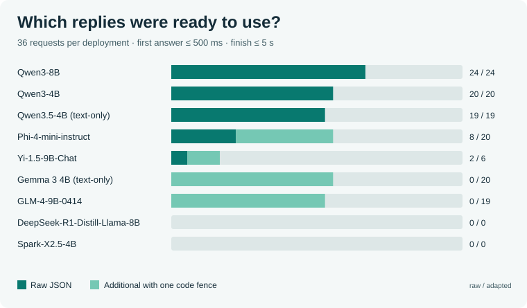

# Home Lab results

The scorecard contains 936 requests across 13 deployments. The original
nine measurements and the four lightweight additions use the same corpus
and time budgets. Each model ran 18 cases twice per workload. The
manifest records the original source runs and their timed windows.

[Lightweight deployment and context analysis](lightweight.md) · [Protocol](home-lab.md)

## One person

**Figure 1 | Desk requests scored under two parsing rules.** Each row
summarizes 36 requests (18 fixtures, two repeats). Both markers use the
same replies and deadlines of 500 ms to the first visible answer and 5 s
to completion. Vertical offsets separate the two markers. The line
connects the raw-JSON count to the count after accepting one JSON fence.

**Table 1 | Single-client results.** Latency p95 uses the number of correct
raw replies shown in its row, with a dash for rows with zero correct replies.
Peak VRAM is measured across both workloads for each deployment.

| Deployment | Raw correct | Raw on time | On time with fence | Raw usable/min | Output tok/s | Visible p95 (ms) | Finish p95 (ms) | Peak MiB |
|---|---:|---:|---:|---:|---:|---:|---:|---:|
| Qwen3-8B | 24/36 | 24/36 | 24/36 | 71.9 | 35.2 | 460 | 752 | 4922 |
| Qwen3.5-2B (text-only) | 22/36 | 22/36 | 22/36 | 126.2 | 73.8 | 250 | 398 | 1753 |
| Qwen3-4B | 20/36 | 20/36 | 20/36 | 76.3 | 52.7 | 291 | 568 | 3244 |
| Qwen3.5-4B (text-only) | 22/36 | 19/36 | 19/36 | 60.5 | 30.9 | 513 | 746 | 3270 |
| LFM2.5-1.2B-Instruct | 12/36 | 12/36 | 12/36 | 134.8 | 161.7 | 93 | 173 | 1199 |
| Qwen3.5-0.8B (text-only) | 12/36 | 12/36 | 16/36 | 85.8 | 108.4 | 162 | 281 | 1009 |
| Phi-4-mini-instruct | 8/36 | 8/36 | 20/36 | 34.1 | 56.2 | 276 | 502 | 3158 |
| Yi-1.5-9B-Chat | 2/36 | 2/36 | 6/36 | 3.3 | 37.5 | 132 | 705 | 5124 |
| Spark-X2.5-4B | 12/36 | 0/36 | 0/36 | 0.0 | 64.3 | 2676 | 2827 | 2926 |
| DeepSeek-R1-Distill-Llama-8B | 2/36 | 0/36 | 0/36 | 0.0 | 51.9 | 3129 | 3474 | 4806 |
| Gemma 3 4B (text-only) | 0/36 | 0/36 | 20/36 | 0.0 | 49.9 | — | — | 3088 |
| GLM-4-9B-0414 | 0/36 | 0/36 | 19/36 | 0.0 | 36.0 | — | — | 5180 |
| SmolLM3-3B | 0/36 | 0/36 | 16/36 | 0.0 | 67.1 | — | — | 2533 |

Latency percentiles use correct raw replies. Token rate includes reported reasoning tokens.

## Small batch

**Table 2 | Four-client results.** The first-answer and completion
deadlines are 2 s and 8 s. Each row summarizes 36 requests.

| Deployment | Raw correct | Raw on time | On time with fence | Raw usable/min | Output tok/s | Visible p95 (ms) | Finish p95 (ms) | Peak MiB |
|---|---:|---:|---:|---:|---:|---:|---:|---:|
| LFM2.5-1.2B-Instruct | 12/36 | 12/36 | 12/36 | 169.0 | 201.4 | 487 | 616 | 1199 |
| Qwen3.5-2B (text-only) | 22/36 | 22/36 | 22/36 | 148.2 | 86.7 | 814 | 1203 | 1753 |
| Qwen3-4B | 20/36 | 20/36 | 20/36 | 98.0 | 67.7 | 1297 | 1594 | 3244 |
| Qwen3.5-0.8B (text-only) | 11/36 | 11/36 | 15/36 | 97.3 | 133.7 | 582 | 811 | 1009 |
| Qwen3-8B | 24/36 | 24/36 | 24/36 | 97.0 | 47.4 | 1602 | 2109 | 4922 |
| Qwen3.5-4B (text-only) | 23/36 | 23/36 | 23/36 | 77.5 | 32.8 | 1877 | 2477 | 3270 |
| Phi-4-mini-instruct | 7/36 | 7/36 | 19/36 | 41.5 | 77.9 | 943 | 1299 | 3158 |
| Yi-1.5-9B-Chat | 2/36 | 1/36 | 7/36 | 2.4 | 52.4 | 2222 | 3378 | 5124 |
| Gemma 3 4B (text-only) | 0/36 | 0/36 | 20/36 | 0.0 | 59.9 | — | — | 3088 |
| DeepSeek-R1-Distill-Llama-8B | 1/36 | 0/36 | 0/36 | 0.0 | 91.8 | 7227 | 7596 | 4806 |
| GLM-4-9B-0414 | 0/36 | 0/36 | 19/36 | 0.0 | 56.1 | — | — | 5180 |
| Spark-X2.5-4B | 12/36 | 0/36 | 0/36 | 0.0 | 99.3 | 7110 | 7396 | 2926 |
| SmolLM3-3B | 0/36 | 0/36 | 14/36 | 0.0 | 86.3 | — | — | 2533 |

Latency percentiles use correct raw replies. Token rate includes reported reasoning tokens.

## Which jobs did they get right?

Single-user results with one JSON code fence accepted.

| Deployment | Extract | Mask | Archive lookup | English | Chinese | Masking misses / visible replies |
|---|---:|---:|---:|---:|---:|---:|
| Qwen3-4B | 8/12 | 2/12 | 10/12 | 8/18 | 12/18 | 6/12 |
| Phi-4-mini-instruct | 10/12 | 2/12 | 8/12 | 10/18 | 10/18 | 10/12 |
| Gemma 3 4B (text-only) | 10/12 | 2/12 | 8/12 | 10/18 | 10/18 | 2/12 |
| Qwen3.5-4B (text-only) | 10/12 | 4/12 | 8/12 | 10/18 | 12/18 | 4/12 |
| Qwen3-8B | 10/12 | 4/12 | 10/12 | 8/18 | 16/18 | 6/12 |
| DeepSeek-R1-Distill-Llama-8B | 2/12 | 0/12 | 0/12 | 0/18 | 2/18 | — |
| GLM-4-9B-0414 | 12/12 | 4/12 | 8/12 | 10/18 | 14/18 | 0/12 |
| Yi-1.5-9B-Chat | 6/12 | 0/12 | 2/12 | 8/18 | 0/18 | 6/12 |
| Spark-X2.5-4B | 10/12 | 0/12 | 2/12 | 4/18 | 8/18 | — |
| Qwen3.5-0.8B (text-only) | 10/12 | 0/12 | 6/12 | 8/18 | 8/18 | 10/12 |
| LFM2.5-1.2B-Instruct | 8/12 | 0/12 | 4/12 | 10/18 | 2/18 | 6/12 |
| Qwen3.5-2B (text-only) | 10/12 | 2/12 | 10/12 | 12/18 | 10/18 | 8/12 |
| SmolLM3-3B | 8/12 | 0/12 | 8/12 | 10/18 | 6/18 | 4/12 |

[Request rows and run manifest](../results/current/home-lab/) · [Dashboard](https://jfang2048.github.io/llm_benchmark/#home-lab)
