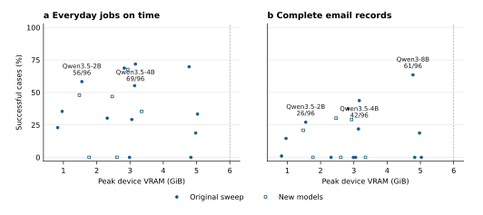
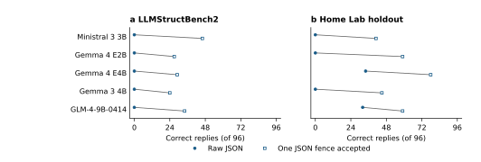

# 6 GiB 的显卡，留哪个模型常驻？

只测 18 道题时，我会选 Qwen3.5-2B。扩到 192 道之后，我会把日常小活交给
**Qwen3.5-4B**。在这台 WSL2 的 RTX 3060 笔记本上，它在 96 道新编的中英文
提取、遮盖和查找任务里按时做对 **69 道**，2B 做对 **56 道**。峰值显存由
1,591 MiB 增到 3,239 MiB。新加入的 Nemotron 3 Nano 4B 在 3,003 MiB 下按时做对 65 道。

*每个点是一套部署。图中标出了不同显存预算内得分最高的模型，每个面板各有 96 道题。*

**换成整封邮件，Qwen3-8B 的优势更明显。** 在 96 道公开邮件题里，8B 完整
做对 61 道，4B 和 2B 分别做对 42 道和 26 道。8B 峰值为 4,891 MiB。
显存还要留给其他应用时，我会选 4B。经常把复杂邮件转成 JSON 时，我会留出空间跑 8B。

两轮共覆盖 19 套部署，每套重放同一批 192 道题。复测 Qwen3.5-4B 时，192 道题的
正确判定和按时判定逐题一致。公开语料取自 HTW Berlin 在 2026 年 11 月发布的
LLMStructBench2，首轮权重的可核实版本早于语料发布。
中英文题在本轮新生成，题目与对照答案在开跑前冻结。[样本来源、实验方法与图表](../fresh.md)

**有些模型把正确答案放在代码围栏里。** Gemma 4 E4B 的日常题严格评分为 34/96，
接受一层 Markdown 围栏后是 78/96。图中两种口径用的是同一批回复。

[新增模型与复测明细](../model-refresh.md) · [故障知识库](../troubleshooting.md) · [交互结果](https://jfang2048.github.io/llm_benchmark/#fresh) · [原始请求记录](../../results/current/fresh/) · [早期单变量对照](../controlled.md) · [English README](../../README.md)
